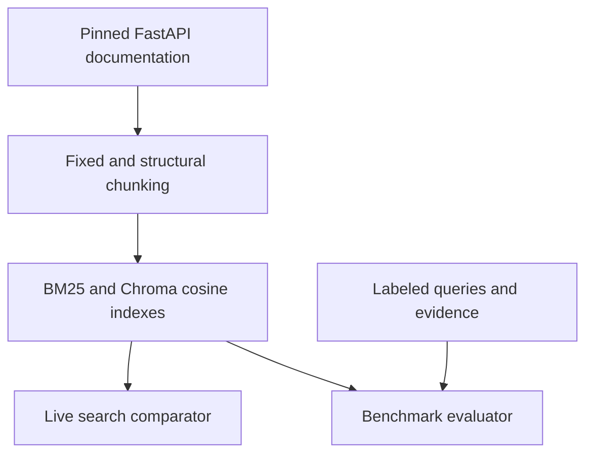

# SearchWorkbench

John Nelson · AD 331 · Semantic Document Search Engine and Empirical Retrieval Benchmarking

Search a versioned FastAPI tutorial corpus side by side with BM25 and dense cosine retrieval. Run the 18-query evaluation from the dashboard and inspect the results that explain where the two rankings disagree.



## Run locally

From the project directory in PowerShell or a terminal, with uv installed:

```powershell
uv sync --locked
uv run --locked python -m src.model_files
uv run --locked uvicorn src.app:app --port 8002
```

Open <http://localhost:8002>. Model and tokenizer files need a one-time
download. The model is loaded locally, and the app builds its four search
configurations at startup. Wait for **Application startup complete** before
opening the dashboard. There is no paid API call. Optional configuration is
documented in `.env.example`; environment variables are read from the process.

```powershell
uv run --locked pytest -v
uv run --locked python -m src.workbench
```

The tests include real ONNX and Chroma retrieval as well as deterministic
metric tests. Initial index construction may take about a minute on CPU.
Tests use the local model cache once it is populated.

## Corpus and evaluation

- **Corpus:** 12 English FastAPI tutorial chapters from
  [release 0.115.6](https://github.com/fastapi/fastapi/tree/0.115.6/docs/en/docs/tutorial),
  approximately 16,400 whitespace-delimited words including examples. See
  [corpus provenance](docs/corpus.md) and the included [MIT license](corpus/LICENSE).
  Markdown is preserved; HTML support normalizes headings and preformatted blocks
  into Markdown-like text, and line numbers then refer to that normalized text.
- **Labels:** `data/eval_queries.json` holds nine identifier-oriented and nine
  conceptual queries. Each expected evidence excerpt occurs exactly once in
  its source file. Labels map by source character span independently for each
  chunker. Query and label files do not enter either index.
- **Chunking:** 256 tokens with 32 overlap, 1,024 with 128 overlap, and heading
  boundaries with code fence protection. Fixed windows use the original
  `cl100k_base` token stream. If a token boundary lands inside a multi-byte
  character, the display span expands to whole characters without dropping text.
- **Engines:** BM25 uses the structure-aware chunks and the same tokenizer for
  queries and documents. Dense search uses normalized 512-dimensional Jina v2
  small English embeddings and Chroma cosine distance, displayed as
  `1 - distance`. The pinned ONNX model supports long inputs; the chunker's
  token counts and model tokenizer are separate. BM25 scores and cosine
  similarities have different scales, so compare ranks and relevance, not scores.

## Benchmark methodology

- **Hit Rate@K:** Fraction of queries with at least one relevant result in the
  first K positions.
- **Recall@K:** Average fraction of labeled evidence spans covered by a top-K
  chunk. Several overlapping chunks covering the same span count once. An
  uncovered span stays in the denominator.
- **MRR@K:** Mean of the reciprocal rank of the first relevant hit. A miss
  scores zero; ties in BM25 are resolved by chunk ID.
- **Latency:** Measure retrieval at K=10 after indexes are built, then use
  the prefixes for quality at K=3, 5 and 10. Report mean, p50 and p95; model
  encoding is timed separately for dense queries. These are local sample
  measurements, not an SLA or a cloud benchmark.

## Empirical findings

Snapshot: Python 3.11, local CPU workspace, 18 labeled queries. Re-run on your machine for new timing measurements.

| Configuration | Chunks | Hit Rate@5 | Recall@5 | MRR@5 | Mean lookup (ms) | p95 lookup (ms) | Mean encode (ms) |
|---|---:|---:|---:|---:|---:|---:|---:|
| BM25 · structure-aware | 146 | 0.611 | 0.611 | 0.528 | 0.74 | 0.99 | 0.00 |
| Dense · 256 tokens | 142 | 0.500 | 0.500 | 0.370 | 1.13 | 1.62 | 5.66 |
| Dense · 1024 tokens | 38 | 0.722 | 0.722 | 0.562 | 0.84 | 1.22 | 5.66 |
| Dense · structure-aware | 146 | 0.722 | 0.722 | 0.602 | 0.86 | 1.16 | 5.66 |

Structure-aware dense and 1,024-token dense found evidence on the same fraction of queries at K=5, but structure-aware dense ranked the first relevant result higher on average. The 256-token windows had the lowest hit rate on this corpus. Longer windows may preserve more context, and headings may help keep topics distinct, but this experiment does not isolate either mechanism. BM25 and structure-aware dense share identical chunks, so that pair more directly tests the retrieval method.

BM25 ranked the labeled expose_headers passage first while structure-aware dense missed it at K=5. Dense ranked evidence about mixed sync and async dependencies first while BM25 missed it at K=5. Search lookup timings are small at this index size, while dense search also pays the query encoding cost. These 18 examples are useful for illustrating trade-offs, not for forecasting latency or asserting that one approach wins on another corpus.

Raw output: [data/benchmark_results.json](data/benchmark_results.json).

## Audit and recording

Read [AI prompt and audit log](ai_prompt_log.md), [original failing tests](docs/audit-baseline-test.txt),
and [before/after patch](docs/audit-fixes.patch). The draft credited hits outside K
and misread comments inside fenced code blocks as section headers. The two
regressions fail on the original draft and pass after correction.

The [recording outline](docs/video-walkthrough.md) gives a timed sequence
for showing the source code, both searches, the live benchmark, and pytest.

## Deployment

For a local container, start Docker Desktop, then run:

```powershell
docker compose up --build -d --wait
```

Open <http://localhost:8002>. Stop it with `docker compose down`.
For Option A, after pushing to GitHub, choose **Deploy a Web Service** in
Render, select the repository and Docker runtime, and set **Health Check Path**
to `/healthz`. The container binds to `0.0.0.0` and honors Render's `PORT`.
Choose a tier only after checking cold startup time and peak memory on the
deployment. The bundled corpus is read-only and indexes rebuild at startup.
The Docker configuration is supplied; Docker build and Render deployment still
need to be verified on the target environment. See [Render Docker docs](https://render.com/docs/docker).
